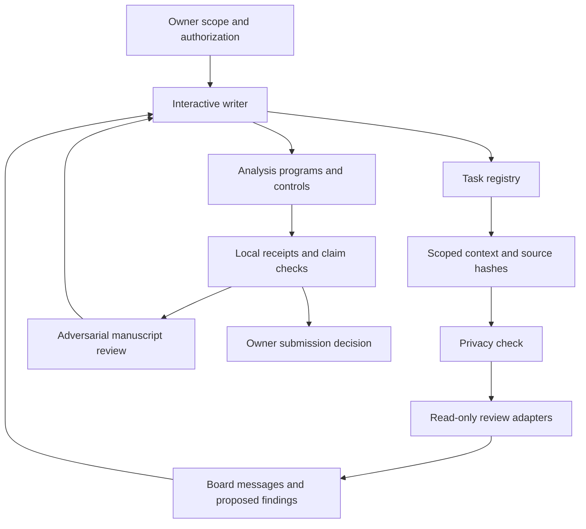

# Agent workflow used in the research project

This document describes the coordination code, operating rules and separate analysis checks used in the research project.
It was added on October 24, 2026, after the owner's competition submissions.
It does not represent a new experimental result or a reconstruction of private conversations.

## Human and agent roles

William Guesdon describes his main role as the setup of the agent environment and workflow.
He supplied project direction, configured access and account settings, set resource limits, approved consequential actions and submitted the competition materials.
Agents wrote code, ran authorized analyses, examined evidence, drafted reports and reviewed defects.
This division of work does not imply that the owner independently checked every scientific judgment.
The project attribution rules required each report to state the extent of human checks and any missing model attribution.

| Role | Responsibility | Boundary |
|---|---|---|
| Owner | The owner defines scope, access, resource limits and submission decisions. | A model response does not supply owner authorization. |
| Writer | An interactive agent implements code and document changes. | The writer must support claims with source evidence and analysis records. |
| Research reviewer | A configured reviewer examines one task and proposes tests or defects. | The reviewer receives a bounded context and uses the review adapter. |
| Board controller | The controller freezes task scope, dispatches turns and records messages. | A board decision remains a proposal for the writer. |
| Analysis program | A program computes benchmark metrics, controls or evidence checks. | A test pass supports its declared check, not a broader clinical claim. |
| Adversarial reviewer | A separate model session challenges the manuscript and its evidence. | Its scores simulate a review and do not predict the actual jury. |

The research project used interactive Claude Code and Codex sessions, plus scripted model calls for selected reviews and summaries.
The exported adapters support `claude`, `codex` and `opencode`. OpenCode can select an Amazon Bedrock model.
These are configured execution routes, not proof that every route ran in every analysis.

## Implemented coordination

The writer and submission decision are operational roles outside the board dispatcher.
The diagram does not imply that a single command automates the complete research process.

| Component | Implemented behavior |
|---|---|
| [`research.py`](../harness/research.py) | The registry stores immutable task contracts, source hashes, deliveries, returns and proposed findings. |
| [`blackboard.py`](../harness/blackboard.py) | The board validates shared scope, freezes context, limits calls, checks message recipients and records work states. |
| [`swarm.py`](../harness/swarm.py) | The dispatcher checks task classes, limits concurrent calls and records each result independently. |
| [`headless.py`](../harness/headless.py) | The adapters build restricted review commands, filter environment variables, inspect terminal events and redact known credentials. |
| [`privacy_guard.py`](../harness/privacy_guard.py) | The guard checks class ceilings, content patterns and local deny tokens. It also implements the structured publication check. |
| [`class_b2_command_guard.py`](../harness/class_b2_command_guard.py) | The command checker detects selected operations on restricted paths and report includes. |
| [`cost_guard.py`](../harness/cost_guard.py) | The cost checker compares project spend and launch estimates with configured limits when a caller invokes it. |

The command checker and cost checker do not intercept every shell command automatically.
The review adapter depends on the selected CLI honoring its restrictions.
The tests use mocked calls and do not independently verify a live provider sandbox or account settings.

## Task contracts and discussion

A task records `task_id`, `phase`, `track`, `assignee`, `question`, `criterion`, `control`, `target`, `suite_hash` and `data_class`.
The registry accepts phases 1, 2 and 4. The board and swarm require phase 4.
The accepted tracks are `t1_strategy`, `t1_rank`, `t1_call` and `t2_drug`.
A new contract needs a new task identifier.

Shared findings must have matching track, target, control and suite identity.
The registry checks the source hash before it includes a finding in context.
Findings enter the registry as `PROPOSED`. A dismissal requires a reason.

A board accepts two to four reviewers and three to eight rounds.
Its first-round protocol asks reviewers to form proposals without reading peer answers.
Later rounds include eligible posts and references to older posts.
The controller checks recipients and reply identifiers. The first-round instruction also depends on reviewer compliance.
Final decisions propose experiments or changes. They do not certify measured evidence.
The board also records assignment, claim, completion and release messages for work items.

## Configuration used in the project

The public [`config.yaml`](../config.yaml) preserves the following values from the research configuration.
Its comments identify them as example limits for a new user.

| Setting | Value | Scope |
|---|---:|---|
| `swarm.parallel` | 4 | The dispatcher limits concurrent reviewer calls. |
| `swarm.headless_deadline_s` | 1500 | The adapter applies this response deadline. |
| `board.board_max_calls` | 50 | A board cannot request a larger call budget. |
| `aws.monthly_cost_cap_usd` | 300 | The separate cost checker uses this cap. |
| `aws.monthly_cost_warn_usd` | 200 | The separate cost checker uses this warning threshold. |
| `privacy.max_variants` | 25 | The original design proposed this export row limit. It is not a universal scanner enforcement rule. |

The board call cap and AWS cost cap govern different operations.
The configuration does not enforce a universal budget across interactive subscriptions and all provider APIs.
Private account files, cloud roles, storage locations and machine paths are excluded.

## Decision gates and evidence

The project required a gate before a result and an explicit amendment when a gate changed afterward.
An analysis record linked its inputs, code, parameters, tool versions, controls, outputs and verdict.
The blank [decision template](templates/decision_gate.md) and [receipt template](templates/analysis_receipt.json) show that structure.

The general measurement gate proposed in the original design was not implemented in the registry.
`research.check_evidence` raises an error whenever measurement evidence is supplied.
There is no public `benchmark_gate.py`, `evidence_gate.py`, `agent_run.py` or `submit.py` implementation.
The original design named those modules, but this documentation does not present them as delivered features.

The project instead used analysis-specific programs and records.
Examples in this export include variant benchmark scripts, [`track2_controls.py`](../scripts/track2_controls.py) and [`check_report_claims.py`](../scripts/check_report_claims.py).
The [methods guide](methods.md) describes their required external inputs.
The [review protocol](review_protocol.md) explains how review defects and evidence checks informed revisions.

## Privacy and attribution

The original data classes separated public material, limited derived findings and source genomic or clinical data.
No model route was authorized to receive raw genomic records or the full clinical document.
The project later amended the policy for limited derived findings under specified account conditions.
The exported automatic dispatcher still uses the earlier conservative A/B/C ceilings.
The [privacy guide](llm_data_privacy.md) distinguishes this implementation from the later policy amendment.

Scripted calls can record the requested model, prompt hash, response status and available provider metadata.
Interactive sessions did not create a complete per-prompt attribution record.
The research records also found that an initialization model identifier could differ from later response identifiers.
The reports therefore must not infer the producer of every judgment from a CLI alias or an initialization event.

## Local examples and retained records

The [walkthrough](harness_walkthrough.md) creates an invented review board and previews its prompts without model calls.
The examples use public repository documentation and contain no research results or participant data.
The local registry, board views, call receipts and transcripts remain in Git-ignored runtime directories.
The public repository supplies the mechanism and blank templates. It does not include historical task conversations or completed research receipts.
